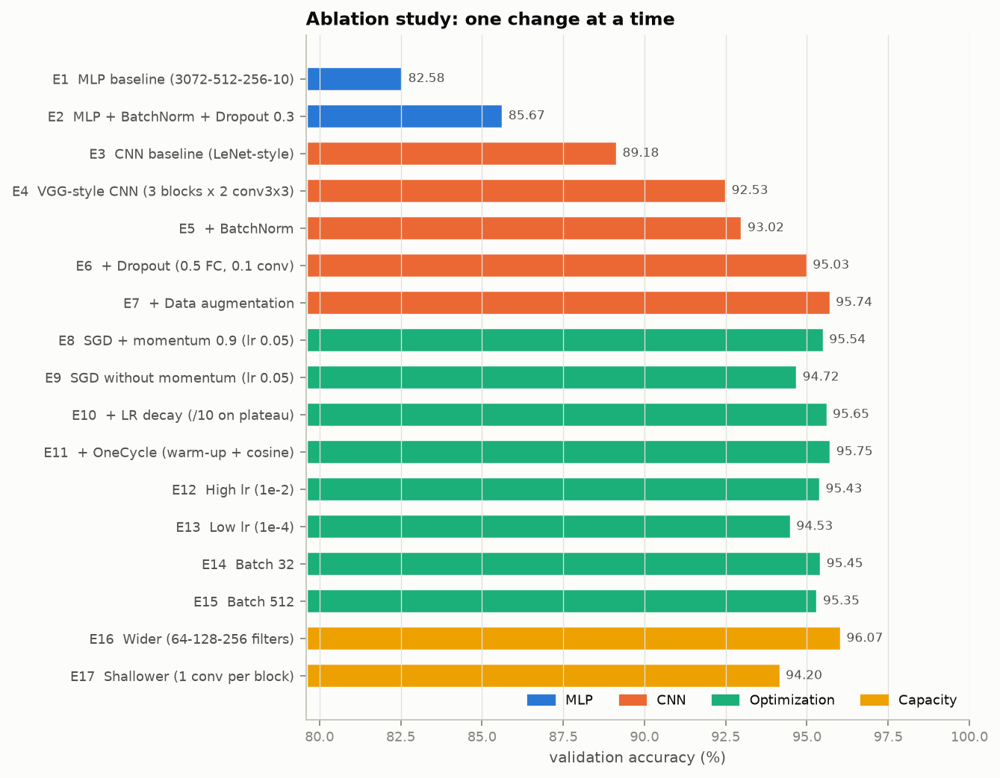
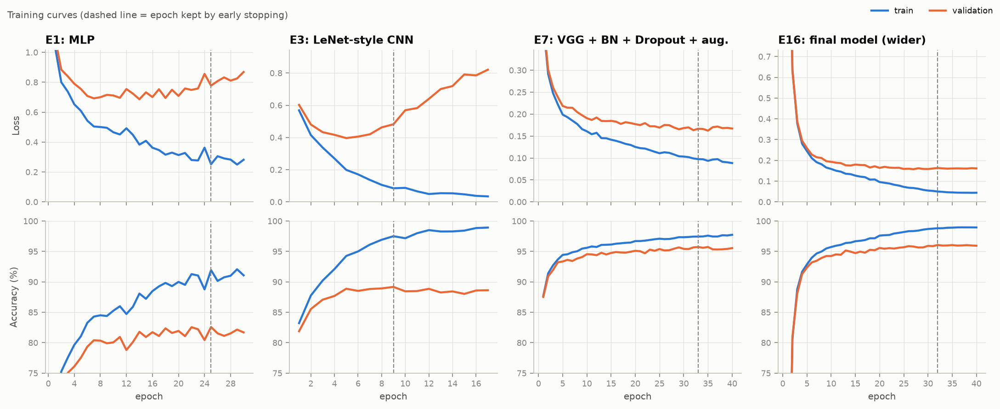
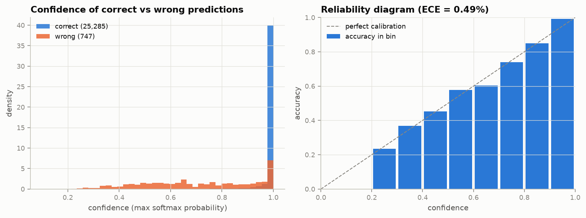
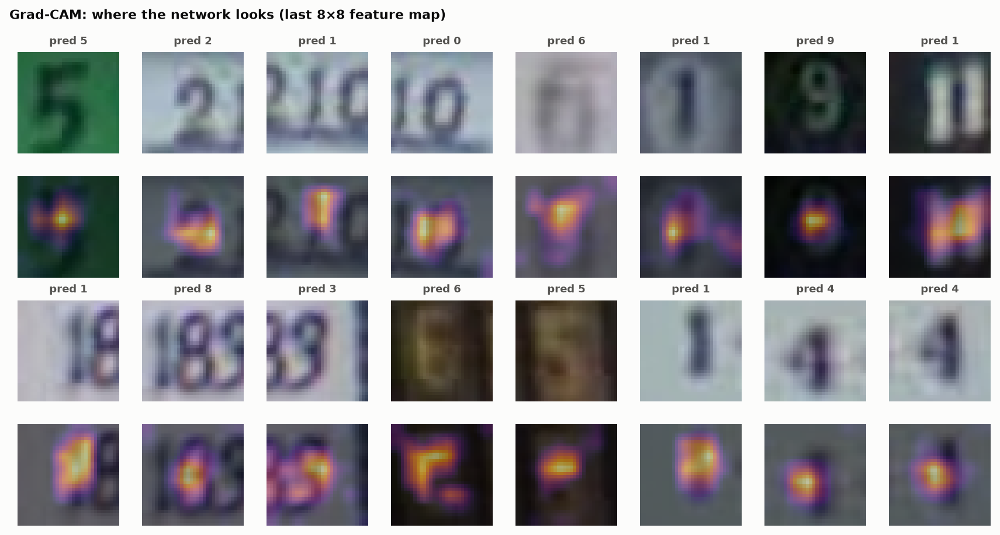
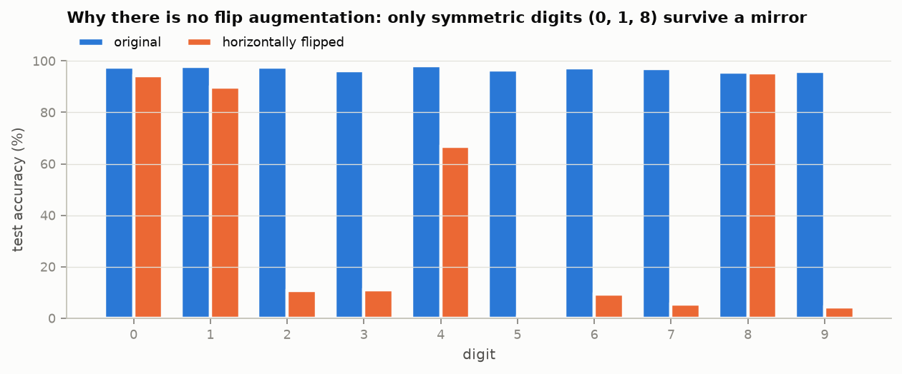
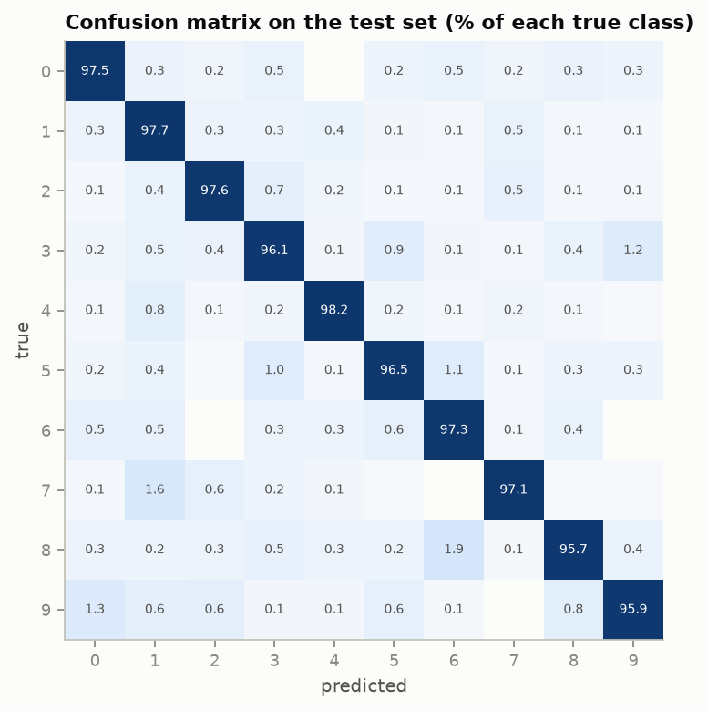
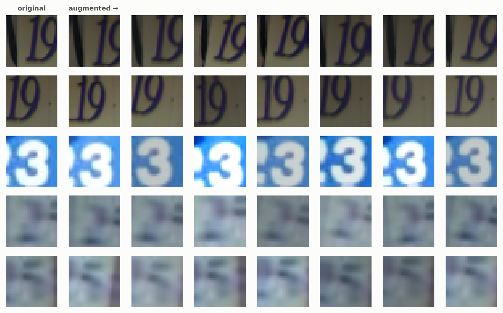

# From MLP to CNN on SVHN: a controlled study

[](https://huggingface.co/arthursilvadantas/SVHN)
[](LICENSE)

📄 Full write-up of every experiment: [`docs/EXPERIMENTS.md`](docs/EXPERIMENTS.md) ·
📓 [Executed notebooks](notebooks/) · 📑 [Report](docs/report/) ·
🤗 [Model + all 17 checkpoints](https://huggingface.co/arthursilvadantas/SVHN)

How much does each design choice actually buy you on real-world digit images? This project answers that with
**17 controlled experiments** on [SVHN](http://ufldl.stanford.edu/housenumbers/) (Street View House Numbers),
going from a plain MLP to a regularized VGG-style CNN and **changing one thing at a time**. The final model
then goes through the checks a single accuracy number hides: calibration, Grad-CAM attention and a
symmetry test that justifies the augmentation policy.

| | |
|---|---|
| **Final model** | VGG-style CNN, 2.2M parameters (experiment E16) |
| **Test accuracy** | **97.13%** (25,285 / 26,032) |
| **Calibration** | ECE **0.49%** |
| **Where it looks** | 83.9% of Grad-CAM mass on the central band where the labeled digit is |



## What mattered (and what didn't)

| Change | Effect on validation accuracy |
|---|---|
| MLP → CNN | **+6.6 p.p.** Convolutions share weights and keep spatial structure; the MLP plateaus around 86% |
| LeNet-style → VGG-style (stacked 3×3 convs) | **+3.4 p.p.** with fewer parameters (814k vs 1.1M) |
| Dropout | **+2.0 p.p.** and the validation loss stops climbing |
| Data augmentation | +0.7 p.p., and the train/val gap falls from 4.1 to 1.7 p.p. |
| Wider network (64-128-256) | +0.3 p.p. for 2.7× the parameters |
| Adam vs SGD + momentum, LR schedules, batch 32/512 | within ±0.4 p.p. Schedules mostly buy stability, not accuracy |
| SGD **without** momentum | −0.8 p.p. and the most unstable curves |

BatchNorm made training converge much faster but, on its own, barely regularized (+0.5 p.p., the network
still memorized the training set at 99.6%). It only paid off combined with Dropout and augmentation.

Full table with test accuracy and parameter counts:
[`results_table.md`](notebooks/outputs/results/results_table.md). Per-technique
analysis, train/val gaps, overfitting diagnostics and the experiment tree:
[`docs/EXPERIMENTS.md`](docs/EXPERIMENTS.md).

### Final recipe (E16)

VGG-style CNN, 3 blocks × 2 conv 3×3 (64-128-256 filters) + BatchNorm, Dropout 0.1 after each block and 0.5 in
the classifier, GPU augmentation (rotation ±10°, shift ±10%, scale 0.9-1.1, brightness/contrast ±20%, **no
flip**), Adam with OneCycle (max lr 1e-3), batch 128, 40 epochs, best epoch by validation accuracy.
2.2M parameters, val. 96.07%, **test 97.13%**.

## Training curves

Overfitting is visible in the unregularized models (E1, E3: validation loss turns upward while training loss
keeps falling); with Dropout + augmentation (E7, E16) the curves move together until the end.



## Beyond accuracy

**Calibration.** When the model says 99%, it is right about 99% of the time. Correct predictions have a mean
confidence of 98.3%, errors 71.6%, so the confidence is a usable signal for flagging doubtful crops.



**Where the network looks.** Grad-CAM on the last 8×8 feature map. SVHN labels the *middle* digit even when
neighbours are visible, and the network learned that convention: 99.1% of test images put more than half of
the activation on the central band. On errors that share drops to 69.6%, often because the model locked on a
neighbouring digit.



**Why no horizontal flip.** Flipping is a default augmentation for natural images, but not for digits. On
mirrored test images accuracy collapses to 40.8%: only the symmetric 0, 1 and 8 survive.



**Errors.** The most common confusions are 8 → 6 (1.9%), 7 → 1 (1.6%), 9 → 0 (1.3%) and 3 → 9 (1.2%),
mostly on blurry or low-contrast crops. Part of the "errors" are actually **wrong labels in SVHN**: 14
independently trained CNNs agree against the label on 136 test images (0.5%), and without them the final model
scores 97.64% ([label-noise audit](notebooks/08_label_noise_audit.ipynb)).

<details>
<summary>Confusion matrix and augmentation examples</summary>




</details>

## Dataset

[SVHN](http://ufldl.stanford.edu/housenumbers/) (Street View House Numbers), *cropped digits* format: 32×32 RGB
crops centered on one digit, 10 classes. This project uses the official `train` (73,257) and `test` (26,032)
splits; the `extra` split (531,131) was not used.

| Source | Link |
|---|---|
| Official page (Stanford) | http://ufldl.stanford.edu/housenumbers/ |
| Kaggle | https://www.kaggle.com/datasets/stanfordu/street-view-house-numbers |
| Hugging Face | https://huggingface.co/datasets/ufldl-stanford/svhn |
| torchvision (used here) | [`torchvision.datasets.SVHN`](https://pytorch.org/vision/stable/generated/torchvision.datasets.SVHN.html) |

No manual download is needed: `torchvision` fetches `train_32x32.mat` and `test_32x32.mat` into `./data` on
first use. If you got the `.mat` files from Kaggle or the Stanford page instead, just place
them in that folder. SVHN is for **non-commercial use only**; cite Netzer et al. (2011) if you use it.

## Quickstart

```bash
git clone https://github.com/ArthurSilvaDantas/svhn-digits && cd svhn-digits
pip install -r requirements.txt
cd notebooks && jupyter lab
```

The study is a sequence of 9 executed notebooks (in Portuguese), one per stage. They are already run, so tables,
plots and analyses render directly on GitHub:

| # | Notebook | Content |
|---|---|---|
| 1 | [`01_data_exploration`](notebooks/01_data_exploration.ipynb) | loading, stratified train/validation split, class distribution |
| 2 | [`02_data_quality`](notebooks/02_data_quality.ipynb) | data cleaning checks: integrity, duplicates, train/test leakage, contrast |
| 3 | [`03_preprocessing`](notebooks/03_preprocessing.ipynb) | per-channel normalization and GPU data augmentation |
| 4 | [`04_models`](notebooks/04_models.ipynb) | MLP, LeNet-style and VGG-style CNNs |
| 5 | [`05_training`](notebooks/05_training.ipynb) | training loop, the 17 experiments, results table |
| 6 | [`06_training_curves`](notebooks/06_training_curves.ipynb) | curves, comparisons, overfitting diagnostics |
| 7 | [`07_final_model`](notebooks/07_final_model.ipynb) | model selection, calibration, Grad-CAM, flip test, cost |
| 8 | [`08_label_noise_audit`](notebooks/08_label_noise_audit.ipynb) | how many SVHN labels are wrong |
| 9 | [`09_unlabeled_set_predictions`](notebooks/09_unlabeled_set_predictions.ipynb) | batch inference on an unlabeled set |

### Pretrained weights

| File on the Hub | What it is |
|---|---|
| [`best_model.pt`](https://huggingface.co/arthursilvadantas/SVHN/blob/main/best_model.pt) | final model (E16) |
| [`ablations/E1.pt` … `E17.pt`](https://huggingface.co/arthursilvadantas/SVHN/tree/main/ablations) | the checkpoint of every experiment, to inspect or compare any step of the study |

```python
# inside notebooks/
from svhn_utils import load_model

model, norm, ckpt = load_model("best_model", "cpu")   # downloaded from the Hub on first use
mlp, norm_mlp, _ = load_model("E1", "cpu")            # any experiment: "E1" ... "E17"
probs = model(norm(x)).softmax(1)                     # x: uint8 tensor [N, 3, 32, 32]
```

## Report

[`docs/report/`](docs/report/) has the full report of the study, with its figures.

## Project layout

```
notebooks/        the 9 notebooks, svhn_utils.py (shared code) and outputs/results/ (saved metrics)
docs/             EXPERIMENTS.md (full study write-up) and the report
figures/          figures used in this README
requirements.txt  dependencies to run the notebooks
```

## License

MIT. SVHN is from Netzer et al., *Reading Digits in Natural Images with Unsupervised Feature Learning*,
NIPS Workshop 2011, and is for non-commercial use.
