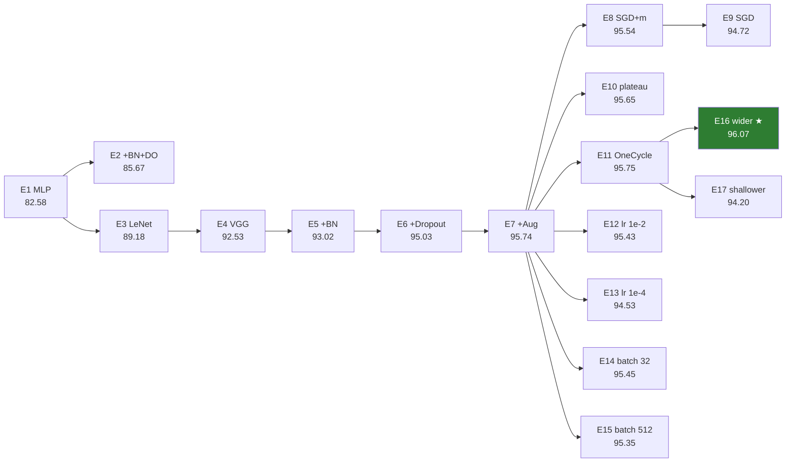

# Experiments

Detailed results of the 17 experiments summarized in the [README](../README.md). Each experiment changes **a single
factor** with respect to its base experiment, so the difference in validation accuracy (Δ) is attributable to it.

## Protocol

| | |
|---|---|
| **Data** | SVHN *cropped digits*; official `train` split 90/10, stratified (65,931 / 7,326); `test` (26,032) for reporting only; `extra` not used |
| **Preprocessing** | per-channel standardization with training-set statistics |
| **Augmentation** | rotation ±10°, translation ±10%, scale 0.9-1.1, brightness/contrast ±20%; no flip (a mirrored digit is another symbol) |
| **Training** | cross-entropy, He initialization, Adam (lr 10⁻³), batch 128, up to 30 epochs with early stopping (patience 8); 40 epochs with augmentation |
| **Selection** | highest validation accuracy; the test set never influenced any decision |
| **Models** | MLP (3072-512-256-10), LeNet-style CNN (2 × conv 5×5), VGG-style CNN (3 blocks × 2 conv 3×3); code in [`svhn_utils.py`](../notebooks/svhn_utils.py) |
| **Setup** | single seed (0), Apple M5 GPU (PyTorch MPS) |

## Experiment tree

Validation accuracy (%); each arrow changes one thing.



## Results

Accuracies in %. **Gap** = train − validation accuracy at the selected epoch (overfitting indicator).

| Exp. | Change | Base | Params | Train | **Val.** | Test | Gap |
|---|---|---|---:|---:|---:|---:|---:|
| E1 | MLP baseline | - | 1.71M | 91.94 | 82.58 | 80.02 | 9.36 |
| E2 | + BatchNorm + Dropout 0.3 | E1 | 1.71M | 91.16 | 85.67 | 83.85 | 5.49 |
| E3 | LeNet-style CNN | E1 | 1.11M | 97.51 | 89.18 | 88.42 | 8.34 |
| E4 | VGG-style CNN | E3 | 0.81M | 97.45 | 92.53 | 92.70 | 4.91 |
| E5 | + BatchNorm | E4 | 0.81M | 99.58 | 93.02 | 92.62 | 6.56 |
| E6 | + Dropout (0.5 FC, 0.1 conv) | E5 | 0.81M | 99.10 | 95.03 | 95.29 | 4.07 |
| E7 | + Data augmentation | E6 | 0.81M | 97.45 | 95.74 | 96.45 | 1.71 |
| E8 | SGD + momentum (lr 0.05) | E7 | 0.81M | 97.21 | 95.54 | 96.58 | 1.68 |
| E9 | SGD without momentum | E8 | 0.81M | 95.88 | 94.72 | 95.97 | 1.17 |
| E10 | LR ÷10 on plateau | E7 | 0.81M | 97.77 | 95.65 | 96.86 | 2.13 |
| E11 | OneCycle schedule | E7 | 0.81M | 97.73 | 95.75 | 96.84 | 1.98 |
| E12 | lr 10⁻² | E7 | 0.81M | 96.99 | 95.43 | 96.37 | 1.56 |
| E13 | lr 10⁻⁴ | E7 | 0.81M | 95.77 | 94.53 | 95.76 | 1.24 |
| E14 | Batch 32 | E7 | 0.81M | 96.93 | 95.45 | 96.53 | 1.48 |
| E15 | Batch 512 | E7 | 0.81M | 96.78 | 95.35 | 96.39 | 1.43 |
| **E16** | **Wider (64-128-256 filters)** | E11 | 2.20M | 98.82 | **96.07** | **97.13** | 2.75 |
| E17 | Shallower (1 conv per block) | E11 | 0.62M | 95.36 | 94.20 | 95.23 | 1.16 |

Per-epoch histories are in [`notebooks/outputs/results/`](../notebooks/outputs/results/) and every checkpoint is
on the [Hugging Face Hub](https://huggingface.co/arthursilvadantas/SVHN/tree/main/ablations).

## Findings

✅ clear gain · ➖ within noise (≤ ~0.4 p.p.) · ❌ worse

| Technique | Comparison | Δ val. | | Why |
|---|---|---:|:-:|---|
| Convolutions | E1 → E3 | **+6.59** | ✅ | weight sharing and local filters handle small shifts; the MLP plateaus at ~86% |
| Stacked 3×3 convs | E3 → E4 | **+3.36** | ✅ | same receptive field as 5×5 with fewer parameters and more non-linearity |
| Dropout | E5 → E6 | **+2.01** | ✅ | stops the validation loss from climbing |
| Data augmentation | E6 → E7 | +0.71 | ✅ | train/val gap falls from 4.1 to 1.7 p.p. |
| Depth | E11 → E17 | −1.56 | ❌ | one conv per block lacks capacity |
| Learning rate 10⁻⁴ | E7 → E13 | −1.21 | ❌ | too slow: still improving after 40 epochs |
| Momentum | E8 → E9 | −0.82 | ❌ | plain SGD converges slower and oscillates |
| BatchNorm alone | E4 → E5 | +0.49 | ➖ | faster convergence, but the model still memorizes (99.6% train) |
| Wider filters | E11 → E16 | +0.31 | ➖ | best model, at 2.7× the parameters |
| Optimizer | E7 → E8 | −0.20 | ➖ | Adam ≈ SGD with momentum |
| LR schedules | E7 → E10/E11 | ±0.10 | ➖ | smoother curves, same accuracy |
| Batch size | E7 → E14/E15 | −0.29/−0.40 | ➖ | 128 is a reasonable default |

**In short:** architecture and regularization drove almost all the gains; optimization settings barely mattered.

## Limitations

- **Single seed:** differences ≤ ~0.4 p.p. should be read as "no clear effect".
- **One path, not a full factorial design:** e.g. Dropout was tested on top of BatchNorm, not alone.
- **No `extra` split:** state-of-the-art SVHN results (~98-99%) train on 531k additional images.

## Reproducing

```bash
pip install -r requirements.txt
cd notebooks && jupyter lab
```

[`05_training.ipynb`](../notebooks/05_training.ipynb) loads the saved results by default; set
`REFAZER_EXPERIMENTOS = True` to retrain all 17 experiments (≈3 h on an Apple M5).
